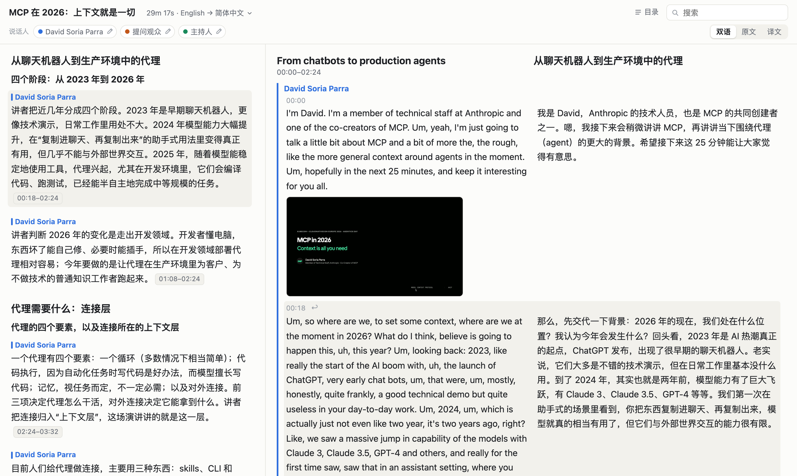

# Watch for Me

[中文](README.md) | English

Watch for Me is a set of skills for AI agents. Give your agent a local video, a recording, or an online video URL, and it transcribes it, separates the speakers, and translates it into an offline reading page: notes organized around the content, each linking back to the passage it came from, beside a bilingual transcript with timestamps and speakers.

Transcription and speaker detection run locally, so recordings are not uploaded. Translation and the notes come from your agent's own model.

Live example: [a reading page for an English tech talk](https://qinmian5.github.io/watch-for-me-demo/) (source and attribution in [watch-for-me-demo](https://github.com/QinMian5/watch-for-me-demo))

[](https://qinmian5.github.io/watch-for-me-demo/)

## Requirements

- An agent that supports Agent Skills.
- A Hugging Face account, to download the speaker detection model. Setup walks you through the access steps.
- On an Apple Silicon Mac: full Xcode and at least 10 GB of free disk space.

Verified on macOS (Apple Silicon) and Windows. Linux and Intel Macs have their own setup route but are not yet tested.

## Let your agent install it

Send this to your agent:

```text
Install Watch for Me by following the README at https://github.com/QinMian5/watch-for-me, then run setup.
```

## Install by hand

### 1. Install

```bash
npx skills add QinMian5/watch-for-me --skill '*'
```

It installs three directories, `watch-for-me`, `setup-watch-for-me`, and `media-shared`. Keep all three.

Claude Code and Codex can also install it as a plugin (if the `plugin` command is missing, update the agent first):

```bash
claude plugin marketplace add QinMian5/watch-for-me
claude plugin install watch-for-me@watch-for-me
```

```bash
codex plugin marketplace add QinMian5/watch-for-me
codex plugin add watch-for-me@watch-for-me
```

Start a new agent session afterwards so the skills appear.

### 2. Run setup

Tell your agent:

```text
Use setup-watch-for-me to configure this environment.
```

Setup asks for the scope (your user account or one repository), the target language, the output folder (default `media`), and the transcription quality, lists the setup actions, and runs them after you confirm.

The speaker detection model needs Hugging Face access. Setup gives you a command to run in your own terminal: it opens the sign-in, model conditions, and token pages in turn, says what to do on each, then asks for a read token in the terminal. The token is not saved; keep it out of chat.

### 3. Start using it

```text
Use watch-for-me on <video URL or file path>
```

When it finishes, open `media.html` from the output folder in a browser. It is a single file and works offline.

Agents name a skill in different ways: for example `/watch-for-me:watch-for-me` in Claude Code and `$watch-for-me` in Codex.

## The two skills

| Skill | What it does |
| --- | --- |
| `watch-for-me` | Produces a bilingual transcript with timestamps and speakers, and notes that each link back to the source. It also answers questions about a recording, pulls excerpts, and renames speakers. |
| `setup-watch-for-me` | Configures the local transcription and speaker models, the target language, and where files are saved. |

## Documentation

- [Installation and first-time setup](docs/install.en.md)
- [Usage](docs/usage.en.md): speaker counts, follow-up questions, and excerpts
- [Output folder and reading page](docs/output.en.md)
- [Configuration](docs/configuration.en.md)
- [Development and tests](docs/development.en.md)

## Feedback

Report problems and ideas in [GitHub Issues](https://github.com/QinMian5/watch-for-me/issues).

## License

[Apache-2.0](LICENSE). Downloaded models and dependencies have their own licenses and access conditions.
